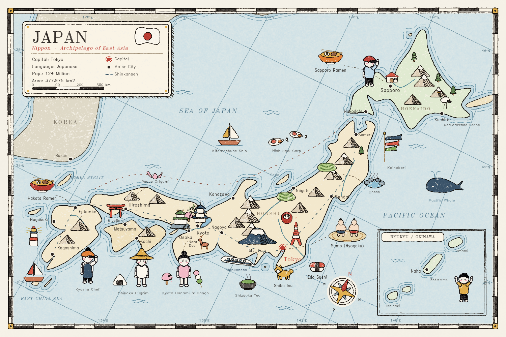
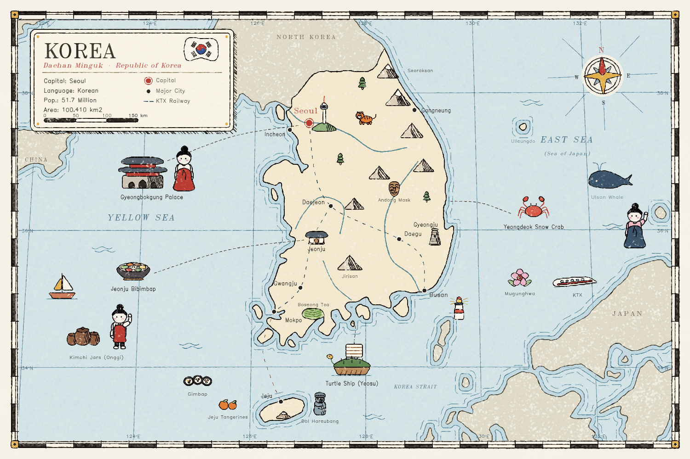

# handdrawn-map-kit

A standalone **hand-drawn illustrated cultural map toolkit** in Node.js — inspired by Aleksandra & Daniel Mizielinski's *Maps* (*《地图（人文版）》*), with a performance-tuned dry-media engine (paper tooth, pencil, technical pen, watercolor wash) extracted from [kevintngo/statechart-art](https://github.com/kevintngo/statechart-art) (MIT).

Zero flowchart/TLA+/Mermaid dependencies — depends solely on `@napi-rs/canvas`.





## Features

- **Any Country**: Coastlines and borders come from the public-domain [Natural Earth](https://www.naturalearthdata.com/) dataset (1:50m bundled). Name a country and the kit loads its outline, fits a projection to it, and draws the neighbours that fall inside the frame.
- **Cartographic Projection & Graticules**: Oblique conformal-like `(lon, lat) -> [x, y]` projection, latitude/longitude curves chosen from the area on the sheet, and neatline degree labels (E/W, N/S).
- **Vintage Atlas Styling**:
  - Alternating black/cream **Zebra Neatline Border** with corner rosettes;
  - Morphological shallow-water bathymetric wash + concentric hand-drawn **coastal waterlines**;
  - Framed parchment **Cartouche** (title, waving flag from 30+ built-ins or your own spec, country facts, map legend, graphical scale bar matched to the projection) & **Inset Map Box**;
  - True-North rotatable **Compass Rose** with rhumb lines.
- **40+ Cultural, Landmark, Animal & Culinary Illustrations**: Mountains, terraced rice fields, bamboo, sakura, pines, torii gates, pagodas, castles, Tokyo Tower, lighthouses, Shinkansen bullet trains, Kitamaebune ships, sumo rings, Shiba Inu, Nara deer, red-crowned cranes, koi carp, whales, ramen/gyudon bowls, sushi, onigiri, dango, matcha, daruma, origami, koinobori; palace gates, hanok, onggi jars, bibimbap, gimbap, dol hareubang, turtle ships, tigers, mugunghwa and hanbok; and parameterized hand-drawn characters (`person`).
- **20x Performance Optimized**: Fast paper-tooth-preserving ocean/border washes, broad pencil side-shading on large landmasses, and dirty-bbox contour extraction (~6 seconds for `--fast` preview, ~20 seconds for `3000×2000` HD).

## Quick Start

```bash
npm install
npm run demo       # Fast preview (~6s, 1500x1000 px) -> out/japan_cultural_map.png
npm run demo:hd    # High-res print quality (~20s, 3000x2000 px) -> out/japan_cultural_map.png
npm run demo:korea     # Korea, fast preview -> out/korea_cultural_map.png
npm run demo:korea:hd  # Korea, 3000x2000 px
```

## Map Any Country

```js
const { createMap } = require('./src');

async function main() {
  const map = createMap({ w: 300, h: 200, seed: 'italy-01' });

  // Fit the projection to the country (code, ISO code or English name)
  const proj = map.fitProjection('Italy');
  map.graticule(proj); // round lon/lat values for whatever area is on the sheet

  // Coastline + borders from Natural Earth; neighbours inside the frame are drawn in grey
  map.countries(proj, { focus: 'Italy' });

  const [x, y] = proj(12.5, 41.9);
  map.city(x, y, 'Rome', { capital: true });

  map.cartouche(13.5, 13, 88, 44, {
    country: 'ITALY',
    flag: 'ITA',
    capital: 'Rome',
    mmPerKm: proj.mmPerKm, // scale bar follows the projection
  });
  await map.save('out/italy.png');
}
main();
```

- `map.fitProjection(country | [west, south, east, north], { frame, rotDeg })` — `frame` is the `[x0, y0, x1, y1]` mm area the country should fill; overseas territories are ignored when fitting.
- `map.countries(proj, { focus, neighbors, color, neighborColor })` — `focus` is one country or a list; `neighbors` is `true` (auto), `false`, or a list. Returns the drawn rings so you can reuse them.
- `map.countryRings(proj, country)` — just the smoothed outline in mm, for `map.part()` / `map.coastWaterlines()`.
- `map.graticule(proj, { step, lons, lats })` — all optional.
- `flag` — a built-in (`FLAGS`: JPN, KOR, CHN, FRA, DEU, ITA ...), a spec such as `{ type: 'stripes', dir: 'h', colors: ['#000', '#d00', '#fc0'] }` (also `disc`, `cross`, `star`), or a function `(F) => { F.field(color); F.fill(poly, color); }` drawing in a 13 x 8.4 box.
- `getCountry()`, `listCountries()` and `countriesInBBox()` are exported for direct access to the data.

The bundled 1:50m data suits whole-country maps. For more coastal detail, download the 1:10m `ne_10m_admin_0_countries.geojson` from Natural Earth and pass its path as `source` to `fitProjection` / `countries` / `countryRings`. Country boundaries and names are Natural Earth's; the projection is meant for country and regional maps, not world maps.

## Minimal Example

```js
const { createMap, PALETTE: C } = require('./src');

async function main() {
  const map = createMap({ w: 300, h: 200, seed: 'my-atlas-01', paper: 'hotpress' });
  const proj = map.createProjection({ lon0: 137.6, lat0: 38.2, cx: 160, cy: 100, scale: 0.14, rotDeg: 26 });

  map.graticule(proj, { lons: [130, 134, 138, 142], lats: [34, 38, 42] });

  const poly = map.D.curve(proj.pts([[139.0, 35.0], [140.8, 35.7], [140.9, 38.3], [138.9, 37.9]]), true, 0.22);
  map.coastWaterlines([poly]);
  map.part(poly, C.land);

  const [tx, ty] = proj(139.76, 35.68);
  map.el.tokyoTower(tx + 5, ty - 1.5, 0.58);
  map.city(tx, ty, 'Tokyo', { capital: true });

  map.person(tx - 12, ty + 14, 0.5, {
    seed: 'traveler',
    pose: 'wave',
    hair: 'bob',
    hat: 'conical',
    shirt: { color: C.sakura },
  });

  await map.save('out/my_map.png');
}
main();
```

Output resolution is set by the `ppm` option (pixels per millimetre, default `10`): `createMap({ w: 300, h: 200, ppm: 5 })` renders a 1500×1000 preview.

## Using It From Another Project

```bash
npm install github:wangreng/handdrawn-map-kit
```

```js
const { createMap, createProjection, PALETTE, POSES } = require('handdrawn-map-kit');
```

## Development

```bash
npm run lint    # ESLint
npm test        # node:test suite (projection, elements, poses, PNG output, seed determinism)
```

## Directory Structure

- `src/index.js` — Main `createMap()` entry point
- `src/mapPrimitives.js` — Projection, graticules, coastal waterlines, zebra border, cartouche, compass, inset box, and fast paper-tooth wash
- `src/elements.js` — 40+ reusable cultural, nature, landmark, transport, animal & food illustrations
- `src/geo.js` — Natural Earth country lookup (`getCountry`, `countriesInBBox` ...)
- `src/flags.js` — Built-in cartouche flags and the flag spec renderer
- `data/ne_50m_admin_0_countries.json` — Country outlines, rebuilt with `npm run build:data`
- `src/japanGeo.js` — Hand-simplified `(lon, lat)` coastlines used by the Japan example
- `examples/japan_cultural_map.js` — Full double-page illustrated atlas of Japan
- `examples/korea_cultural_map.js` — Korea, drawn entirely from Natural Earth outlines
- `engine/` — Performance-tuned dry-media & paper simulation engine (`kit/`, `lib/`, `fonts/`)

## Credits & License

MIT License. Country outlines are from [Natural Earth](https://www.naturalearthdata.com/) (public domain). Dry-media simulation (`engine/kit/`), parameterized character rig (`people.js`), and Hershey-derived `Kevin Serif` / `Kevin Sans` fonts originate from [kevintngo/statechart-art](https://github.com/kevintngo/statechart-art) (MIT).
